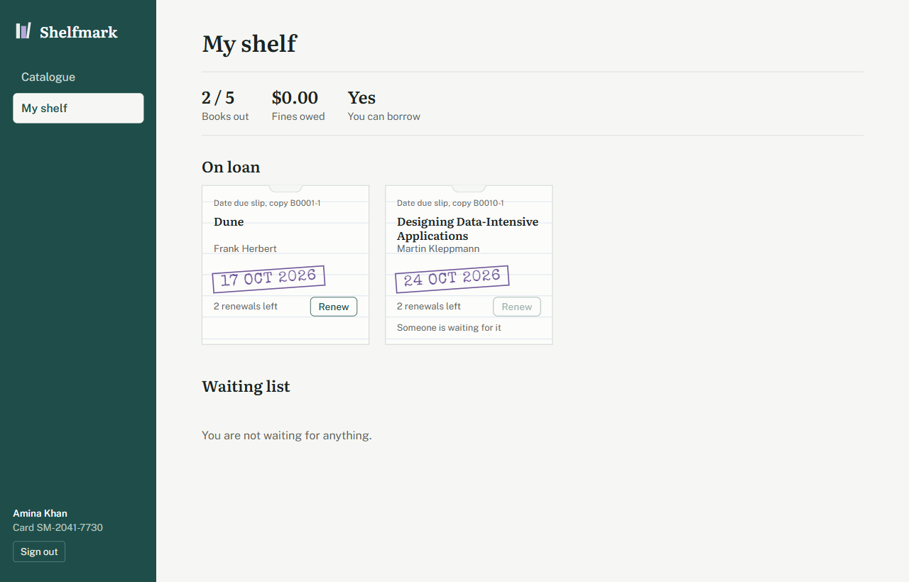
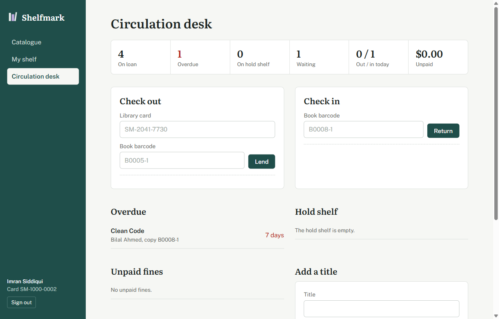

# Shelfmark

**A library circulation backend: borrowing, returns, renewals, hold queues and fines, correct under concurrent requests.**

[](https://github.com/qasimrazamalik-coder/shelfmark-library-api/actions/workflows/ci.yml)


[](LICENSE)

<p align="center">
  
  
</p>

A REST API for running a small library's circulation desk: catalogue search,
borrowing, returns, renewals, a first-come-first-served hold queue, overdue
fines, and an audit trail. Built with Node.js, Express 5 and PostgreSQL, with a
plain-JavaScript frontend served by the same app.

## Highlights

- **Exactly five loans, even when eight checkouts arrive at once**: the member row is locked before counting
- **The last copy goes to one person**: copies are claimed with `FOR UPDATE SKIP LOCKED`, so losers get a clean `NO_COPY_AVAILABLE` instead of waiting on a lock
- **First-come, first-served hold queue** with 3-day pickup windows and a background job that passes uncollected copies down the queue
- **Overdue fines** computed by the database clock, capped at replacement cost, stored as integer cents
- **Weighted full-text search** (`tsvector` + GIN index, title > author > subjects)
- **Partial unique indexes** as a backstop: a copy can never be on two open loans, whatever the application does
- **Audit trail** written in the same transaction as every change

## Run it

Needs Node.js 20 or newer. No PostgreSQL install required.

```bash
npm install
npm run db        # terminal 1: starts a real PostgreSQL on port 5541, leave it running
npm run setup     # terminal 2: creates the tables and loads demo data
npm start         # http://localhost:3001   API docs at /api/docs
```

On Windows PowerShell, if `npm` is blocked by the execution policy, use `npm.cmd`.

Demo accounts, all with password `password123`:

| Role      | Email                     |
|-----------|---------------------------|
| Admin     | admin@shelfmark.test      |
| Librarian | librarian@shelfmark.test  |
| Member    | amina@shelfmark.test      |
| Member    | bilal@shelfmark.test (has an overdue book) |

Prefer Docker? `docker compose up --build`, then `docker compose exec api node scripts/seed.js`.

## Test it

```bash
npm test
```

This starts a throwaway PostgreSQL, migrates it, runs 42 tests with Node's
built-in test runner, and deletes it. The suite includes three race-condition
tests that fire concurrent requests at the real database.

## What the backend does

| Area | Rules enforced |
|------|----------------|
| Borrowing | Max 5 open loans. Blocked while any loan is overdue or unpaid fines reach $10. One copy of a title at a time. |
| Copies | A copy can never be on two open loans (partial unique index). Concurrent borrowers get different copies via `FOR UPDATE SKIP LOCKED`. |
| Returns | Late fine of 25 cents per started day, capped at the book's replacement cost, computed by the database clock. |
| Renewals | Max 2, never when overdue, never when someone is waiting for the title. |
| Holds | Only for titles with no copy on the shelf. A returned copy goes to the first person waiting and is reserved for 3 days. Uncollected holds expire every minute and the copy moves down the queue. |
| Lost items | Staff close the loan and charge the replacement cost. |
| Fines | Staff record payment. Only admins can waive, and must give a reason. A fine cannot be settled twice. |
| Audit | Every state change writes an audit row in the same transaction. |

### How concurrency is handled

- **Member loan limit.** Checkout locks the member's row (`SELECT ... FOR UPDATE`)
  before counting their loans, so eight simultaneous requests are serialised and
  exactly five succeed. See `tests/circulation.test.js`, "RACE" tests.
- **Last copy.** Copies are claimed with `FOR UPDATE SKIP LOCKED`, so when ten
  people race for one copy, one wins and nine get `NO_COPY_AVAILABLE` instead of
  queueing on a lock.
- **Hold queue.** The next waiting hold is also taken with `SKIP LOCKED`, so two
  copies freed at once go to two different people.
- **Backstop.** If application logic were bypassed, the partial unique indexes
  (`loans_one_open_per_copy`, `holds_one_active_per_member`) still reject the
  bad write, and the error handler turns it into a clean 409.

### Design decisions worth discussing

- **Money as integer cents** avoids floating-point rounding.
- **Full-text search** uses a weighted `tsvector` (title > author > subjects)
  kept up to date by a trigger, with a GIN index. User input is reduced to
  letters and digits before it becomes a prefix query, so it can't break the
  query syntax or inject SQL.
- **Errors have stable codes** (`LOAN_LIMIT`, `TITLE_ON_HOLD`, ...). The
  frontend and tests branch on the code, never on the message text.
- **Members get 404, not 403,** for other people's loans and holds, so record
  ids can't be probed.
- **Policy lives in config** (`LOAN_DAYS`, `MAX_ACTIVE_LOANS`, ...), so the rules
  can change without code changes.

## Project layout

```
db/migrations/      SQL schema: tables, enums, partial indexes, trigger, view
docs/openapi.yaml   API specification, served at /api/docs
public/             frontend (HTML, CSS, vanilla JS)
scripts/            dev database, migrations, seed data, test runner
src/
  app.js            Express app: security headers, routes, docs, errors
  config.js         environment and circulation policy
  db.js             connection pool, transaction helper, audit writer
  middleware/       auth (JWT + roles), zod validation, error mapping
  modules/
    auth/           register, login, current user
    books/          catalogue search, titles, copies
    loans/          checkout, return, renew, lost (service.js holds the rules)
    holds/          hold queue and the expiry job
    fines/          list, pay, waive
    members/        staff member lookup and role changes
    reports/        desk summary, popular titles, activity, audit, copy status
tests/              auth, catalogue and circulation suites
```

## API overview

Full spec at `/api/docs` once running. Main endpoints:

| Method | Path | Who |
|--------|------|-----|
| POST | /api/auth/register, /api/auth/login | anyone |
| GET | /api/books?q=&subject=&available= | anyone |
| POST | /api/books, /api/books/:id/copies | staff |
| POST | /api/loans | member (by bookId) or staff (by barcode + card) |
| POST | /api/loans/return | staff |
| POST | /api/loans/:id/renew | owner or staff |
| POST | /api/loans/:id/lost | staff |
| GET, POST, DELETE | /api/holds | member, staff |
| POST | /api/fines/:id/pay | staff |
| POST | /api/fines/:id/waive | admin |
| GET | /api/staff/summary, /popular, /activity, /audit | staff |

## Contributing

Issues and pull requests are welcome. Every push and pull request runs the full test suite against PostgreSQL 16 on Node 20 and 22, checks runtime dependencies with `npm audit`, and builds the Docker image. `main` is protected: changes go through a pull request with a green build.

## Security

Please report vulnerabilities privately; see [SECURITY.md](SECURITY.md). The demo accounts and development secrets are for local use only.

## License

[MIT](LICENSE) © 2026 Qasim Raza Malik
